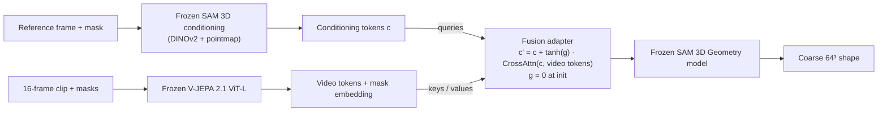

# Research plan: video input for SAM 3D via V-JEPA 2.1 fusion

**Working title:** *Can video context help SAM 3D see behind occluders? Fusing V-JEPA 2.1 features into a frozen single-image 3D reconstructor.*

Group mini research project, 3 weeks (about 10 working days plus buffer). **Guiding principle:** change as little as possible. SAM 3D and both encoders stay **frozen**; we train **one small fusion module** and evaluate **coarse shape only** on **synthetic data with full 3D ground truth**.

## 1. Research question and hypotheses

**Question.** Does injecting temporally aggregated features from a self-supervised video encoder into SAM 3D's conditioning space improve 3D shape reconstruction of partially occluded objects, without retraining SAM 3D?

| | Hypothesis | Test |
|---|---|---|
| **H1** | Video context improves shape accuracy over single-frame SAM 3D, and the gain grows with occlusion of the reference frame | C3 vs. C0 / C1 |
| **H2** | Video features (V-JEPA 2.1) help more than per-frame image features (DINOv2) of the same frames, fused by the same module | C3 vs. C2 |
| **H3** (optional) | Part of the gain comes from temporal structure, not just more pixels | C3 vs. C3-shuf |

**Novelty.** SAM 3D is single-image. Lift4D adapts it to video through causal latent propagation (optimisation-based, not encoder fusion), and MV-SAM3D (a community fork) averages latents. To our knowledge nobody has fused a video encoder into SAM 3D's conditioning tokens; a short novelty search should confirm this.

**Course link:** self-supervised representation learning (JEPA, DINOv2), generative models (rectified flow matching), attention-based fusion, 3D vision.

## 2. Feasibility

- **SAM 3D:** checkpoints released Nov 2025, encoder weights 2026-06-01 (needed to encode GT shapes into SAM 3D's latent space). The repo is inference-only, so we wrote our own flow-matching training loop. The checkpoints are gated on Hugging Face, and SAM 3D needs ≥ 32 GB VRAM.
- **Compute:** UCloud B200 GPUs (with a newer torch than SAM 3D pins; see [UCloud guide](ucloud.md)); Google Cloud as an alternative.
- **V-JEPA 2.1:** learnable image/video modality tokens, so the same encoder handles single images and clips. ViT-L to save compute.
- **Data:** our own generator ([`synthetic-data`](../../synthetic-data/README.md), [data format](../../synthetic-data/docs/data_format.md)), with exact masks, depth, poses and 64³ voxels; the model reads its packed training export.

## 3. Method

- **Fusion adapter:** two gated cross-attention blocks (~18M parameters). SAM 3D's own conditioning tokens attend to the clip's V-JEPA tokens; the output is added back through gates initialised to **zero**, so training starts exactly at SAM 3D.
- **Object focus:** a learned embedding is added to each video token, weighted by the fraction of the target's visible mask it covers.
- **Training:** SAM 3D's rectified flow-matching loss on the ground-truth shape latent; gradients flow only into the adapter. A random clip length K ∈ {1, 4, 8, 16} lets one model serve all test-time ablations. Features are computed online, which allows crop augmentation.
- **Scope:** Geometry model only (no Texture & Refinement), SAM 3D's default monocular pointmap, shape only. Rotation (Phase B) is optional and waits for the pose converter.

Details: [adapter design](adapter_design.md).

## 4. Experimental design

### 4.1 Data (format v0.1)

32 frames at 512 px per clip (the model uses 16), 1–4 floating objects, a camera orbiting 10–70°, and exact amodal masks for stratification.

| Split | Objects | Clips |
|---|---|---|
| train | Objaverse-XL (TRELLIS-500K subset) | 10,000 (rendered on UCloud, M2) |
| val | train clips that show one of 3 % held-out assets | ≈ 600 |
| eval | Google Scanned Objects | 500 |

Objects and backgrounds never cross splits.

### 4.2 Conditions

The trained conditions share budget, seed, data stream and sampler.

| ID | Condition | Purpose |
|---|---|---|
| C0 | SAM 3D on the reference frame (zero-shot) | Lower bound |
| C0b | SAM 3D on the frame where the object is most visible (oracle) | Strong training-free baseline |
| C1 | Adapter, keys/values = reference-frame DINOv2 only | **Controls for domain fine-tuning and extra parameters** |
| C2 | Adapter, keys/values = DINOv2 tokens of K frames | Video information through an image encoder (H2) |
| **C3** | **Adapter, keys/values = V-JEPA 2.1 tokens (main)** | H1, H2 |
| C3-shuf | C3 with shuffled frames at test time | H3 |
| C3-nomask | C3 without the mask embedding | Ablation |

C1 is the most important control: without it, any gain could be adaptation to the synthetic domain.

### 4.3 Metrics and statistics

- **Shape** (SAM 3D paper protocol D.3.1, normalise + ICP): voxel IoU at 64³, Chamfer distance, F-score @0.02 and @0.05 (a voxel is 1/64 ≈ 0.016, so @0.01 is resolution-limited). In addition, canonical vIoU without alignment.
- **Stratification:** `visible_frac` of the reference frame, arc span, K.
- **Statistics:** paired per-sample differences, 95 % bootstrap CIs over clips, Wilcoxon signed-rank; 2 seeds for C1–C3 if time allows.

### 4.4 Planned results

- [ ] Main table C0–C3
- [ ] Occlusion plot (metric vs. `visible_frac` bin), where H1 should show
- [ ] Scaling plot (metric vs. K); at K = 1, C3 ≈ C1
- [ ] Shuffle, wrong-video and mask ablations
- [ ] Qualitative grid
- [ ] *Stretch:* zero-shot on 30–50 real CO3D / OmniObject3D clips with SAM 2 masks

## 5. Timeline and gates

**Week 1: setup and baselines**
- [ ] SAM 3D access and GPU environment; inspect SAM 3D internals
- [ ] **G0** VAE round-trip (T5) and canonical frame (T4) pass, else **Plan B1**
- [ ] Latent cache; C0 and C0b results; training loop overfits a small set
- [ ] **G1** Baselines and overfit pass, else **Plan B2**
- [ ] Draft related work and introduction

**Week 2: training and experiments**
- [ ] Benchmark → steps per run; train C1, C2, C3, C3-nomask
- [ ] Evaluate with occlusion bins; test-time ablations (K, shuffle, wrong video)
- [ ] **G2** Freeze all numbers; no new experiments after this

**Week 3: writing and buffer**
- [ ] Figures; full draft of methods and experiments
- [ ] Internal review; rewrite introduction and discussion
- [ ] Buffer, polishing, submission

Current status: [progress](progress.md).

## 6. Roles

| Role | Owns |
|---|---|
| **Model** | SAM 3D integration, adapter, training loop; gate G0 |
| **Data** | Generator, splits, pose converter (Julian) |
| **Features and evaluation** | Encoders, metrics, baselines, statistics, plots |
| **Writing and backup** | Related work, method figure, report skeleton; keeps Plan B2 ready |

Everyone writes in week 3.

## 7. Backup plans (same data)

- **B1: same idea, different host.** If SAM 3D's latents or conventions cannot be sorted out by G0, put the same adapter into **TRELLIS** (SAM 3D's base architecture, with open training code) and frame it as a proof of concept.
- **B2: probing study.** Do frozen V-JEPA 2.1 features encode the shape of occluded objects better than DINOv2? Train small probes from mask-pooled features (reference frame vs. clip) to a 32³ occupancy grid, stratified by occlusion. Needs one 24 GB GPU and still tests H1/H2 at the representation level.
- **B3: minimum fallback.** C0 vs. C0b plus feature analysis (PCA visualisations, cross-frame similarity), framed as a diagnostic or negative result.

## 8. Report mapping

| Section | Content |
|---|---|
| Abstract | Question, method in one sentence, main occlusion-stratified result |
| Introduction | Limits of single-image reconstruction, why video helps, H1–H3; contributions: adapter, controlled benchmark, analysis |
| Related work | SAM 3D / TRELLIS; V-JEPA 2 / 2.1, DINOv2; video and multi-view 3D (Lift4D, MV-SAM3D, VGGT); feature probing (Lexicon3D, El Banani et al.) |
| Methods | Formulation $p(S \mid \{I_k, M_k\}_{k=1}^K)$, adapter, zero-init gates, mask embedding, objective |
| Experiments | Setup, conditions, main table, occlusion plot, K scaling, ablations, qualitative results |
| Discussion | Synthetic → real gap, coarse shape only, frozen backbone; future work (3D-anchored fusion, DPO) |

**Own figures:** teaser (occluded object, C0 vs. C3), method diagram, data examples with an occlusion histogram, main / occlusion / K plots, qualitative grid. At most one borrowed figure (SAM 3D architecture, cited).

## 9. Risks

| Risk | Mitigation |
|---|---|
| Backprop through the frozen 1.2B model needs a lot of memory | B200 GPUs, bf16, activation checkpointing; otherwise Plan B2 |
| Canonical frame or latent mismatch | T4 / T5 at G0; aligned metrics use ICP and tolerate frame errors |
| Small objects (median 2.5 % of the frame) | Object-centred clip crops |
| Train split arrives late | Pipeline tested end-to-end on a fake dataset; ask for a dev slice |
| Adapter overfits | Zero-init gates, small adapter, best checkpoint on val, random reference frames and crop jitter |

## 10. Key references

- SAM 3D Team (2025). *SAM 3D: 3Dfy Anything in Images.* [arXiv:2511.16624](https://arxiv.org/abs/2511.16624) · [code](https://github.com/facebookresearch/sam-3d-objects)
- Mur-Labadia et al. (2026). *V-JEPA 2.1: Unlocking Dense Features in Video Self-Supervised Learning.* [arXiv:2603.14482](https://arxiv.org/abs/2603.14482) · [code](https://github.com/facebookresearch/vjepa2)
- Assran et al. (2025). *V-JEPA 2.* [arXiv:2506.09985](https://arxiv.org/abs/2506.09985)
- Oquab et al. (2023). *DINOv2.* [arXiv:2304.07193](https://arxiv.org/abs/2304.07193)
- Xiang et al. (2025). *TRELLIS: Structured 3D Latents.* [arXiv:2412.01506](https://arxiv.org/abs/2412.01506) (Plan B1 host)
- Downs et al. (2022). *Google Scanned Objects.* [arXiv:2204.11918](https://arxiv.org/abs/2204.11918)
- Litman et al. (2026). *Lift4D.* [arXiv:2606.23688](https://arxiv.org/abs/2606.23688) (closest prior work)
- Man et al. (2024). *Lexicon3D.* [arXiv:2409.03757](https://arxiv.org/abs/2409.03757) · El Banani et al. (2024). *Probing the 3D Awareness of Visual Foundation Models.* CVPR (Plan B2)
- Liu et al. (2022). *Rectified Flow.* [arXiv:2209.03003](https://arxiv.org/abs/2209.03003)
- Alayrac et al. (2022). *Flamingo* (gated cross-attention, zero-init tanh gates). [arXiv:2204.14198](https://arxiv.org/abs/2204.14198)
