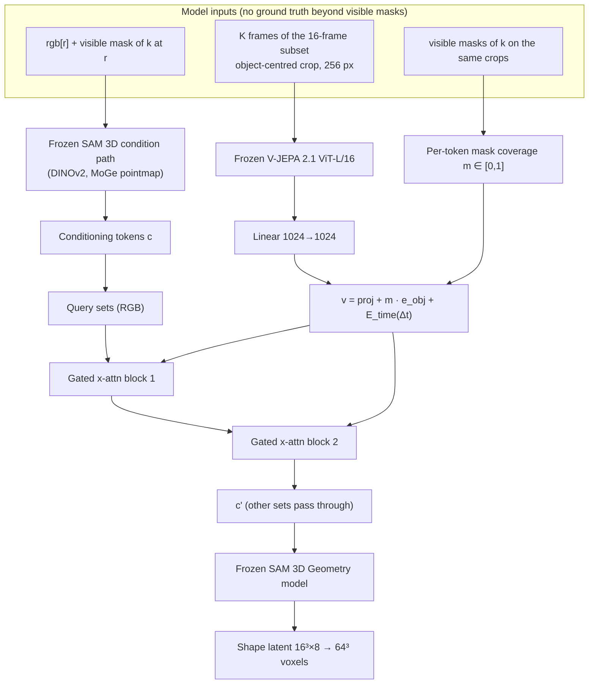

# Fusion adapter: design

A small module (~18M parameters) lets the **frozen** SAM 3D Geometry model see a **video clip**. SAM 3D's conditioning tokens from the reference frame **cross-attend** to **frozen V-JEPA 2.1** tokens of an object-centred clip. The result is added back through **zero-initialised tanh gates**, so at step 0 the system is exactly SAM 3D. A learned **object embedding**, weighted by each token's mask coverage, tells the adapter which video tokens belong to the target.

This page describes the method as implemented. Config keys refer to [`configs/base.yaml`](../configs/base.yaml). The research questions and conditions are in the [research plan](research_plan.md), SAM 3D code facts in [SAM 3D internals](sam3d_internals.md), and status and decisions in [progress](progress.md).

## 1. Consequences of data format v0.1

| Data format v0.1 | Consequence |
|---|---|
| 32 frames at 512 px | The model uses a 16-frame subset (stride 2) |
| 1–4 floating objects, camera orbits 10–70° | Many new viewpoints; arc span is a stratification axis |
| Exact amodal masks and `visible_frac` | Exact occlusion stratification (eval only, never a model input) |
| Train = Objaverse-XL, eval = GSO | Cross-dataset generalisation; val = held-out Objaverse clips in their own split |
| Largest object ≈ 2 % of the image | Object-centred clip crops are mandatory (§3.3) |
| Canonical frame = TRELLIS normalisation; `ours_to_sam3d` pending | Phase A trains shape only; rotation (Phase B) waits for the converter |

## 2. Architecture

| Tensor | Shape | Notes |
|---|---|---|
| Clip frames | (B, K, 3, 256, 256) | K ∈ {1, 4, 8, 16} |
| V-JEPA tokens | (B, K/2 · 16 · 16, 1024) | 2,048 tokens at K = 16; K = 1 uses the image tokenizer (256 tokens) |
| Coverage m | (B, N_v) | token order (t, h, w) |
| Conditioning tokens c | (B, N_c, d_c) | sets and sizes from `inspect-sam3d` |
| Shape latent | (B, 4096, 8) ↔ (B, 8, 16, 16, 16) | VAE encoder mean of the GT voxels, no scaling |

## 3. Samples (`vidsam3d/data/samples.py`)

A sample is (clip, target object k, reference frame r, window W).

### 3.1 What the model may see

Only `rgb` and the target's **visible** mask. Amodal masks, depth, cameras, poses, voxels and meshes are ground truth only. `check_no_leakage` asserts that the model inputs contain only allowed keys, and the crop window is computed from visible masks only.

### 3.2 Frames, reference and window

1. **Subset** S = {o, o+2, …, o+30}; o ∈ {0, 1} random in training, o = 0 in eval.
2. **Reference r**: frames of S where k has ≥ 2 % of its amodal area visible. In training, r is uniform, and with probability 0.5 (`data.p_occluded_bias`) it is weighted ∝ 1 − `visible_frac`. Eval uses the middle frame (t = 16) and the most-occluded frame of S (ties → earliest frame; one sample if they coincide).
3. **Clip length** K ∈ {1, 4, 8, 16} with p = {0.15, 0.15, 0.2, 0.5} in training and K = 16 in eval (`--k` for the test-time ablation). W is the contiguous window of K frames of S containing r, centred where possible.
4. **Δt** of each tubelet is relative to the tubelet containing r (range ±7).

### 3.3 Object-centred crop

- Union of the target's visible-mask bounding boxes over W.
- Square side = max(1.25 × longest side, 128 px), clamped to the image; the same window for all frames, because a moving crop would fake motion.
- Zero-pad outside the image, then resize to 256 px (bilinear for RGB, `area` for masks, so the masks become fractional).
- Training jitter: centre ±10 % and side ×U(0.9, 1.1), the same for all frames. No flips: they change handedness.

### 3.4 Targets (`vidsam3d/data/targets.py`)

`voxels.npy` → canonical permutation P (`target.canonical_permutation`, from T4) → optional interior fill (`target.voxel_fill`, from T5) → SAM 3D VAE encoder mean, cached per asset by `cache-latents`. Phase B would add the rotation target through `ours_to_sam3d`; until then `convert_pose_to_sam3d` raises.

## 4. Key/value encoders (`vidsam3d/models/encoders.py`)

| Condition | Keys/values | Grid |
|---|---|---|
| C1 | SAM 3D's DINOv2, reference frame only (Δt = 0) | 224 px, patch 14 → 16 × 16 |
| C2 | SAM 3D's DINOv2 on K frames, averaged in pairs | 16 × 16 × K/2 (token parity with C3) |
| C3 | V-JEPA 2.1 ViT-L/16 (`vjepa2_1_vit_large_384`), last layer, bf16 | 256 px → 16 × 16 × K/2 |

All encoders are frozen and run online. Inputs use ImageNet normalisation. The coverage function averages the fractional mask per patch, and over the tubelet for V-JEPA and C2. Stretch options: `encoder.vjepa.layers: hierarchical` (4 levels, `adapter.d_vid: 4096`), 384 px.

## 5. Adapter (`vidsam3d/models/adapter.py`)

- Token embedding: v_i = W_in f_i + m_i · e_obj + E_time[Δt_i]. `e_obj` ~ 𝒩(0, 0.02²). `E_time` is a learned table over Δt ∈ [−7, 7].
- Two Flamingo-style blocks: pre-LN cross-attention (16 heads) and an FFN (ratio 2), each added through tanh(g) with g = 0 at init. Batches with different K are padded with a key-padding mask.
- 17.9M parameters at d = 1024: `in_proj` 1.05M, embeddings 0.02M, 8.4M per block. Three blocks would be ≈ 26M.
- At init only the gates get gradient; once g ≠ 0 all adapter weights train. The training log records tanh(g) per block. If the gates stay ≈ 0 after ~2k steps, raise `optim.gate_lr_mult` to 10.
- Query sets (`adapter.query_sets`): the two RGB token sets; all other sets pass through unchanged.

## 6. Integration with SAM 3D (`vidsam3d/models/sam3d.py`)

- The wrapper instantiates the official pipeline from `pipeline.yaml`, keeps the Stage-1 components and splits the fused conditioning tokens into named sets with forward hooks. SAM 3D's source is never modified.
- The adapter runs once per sample; c' is reused for every ODE step.
- CFG: the null branch is zeros (`add_flag` + `force_zeros_cond`) and is never adapted; both are asserted.
- Sampler for every condition: distilled shortcut mode, 4 steps, no CFG (`sampler.*`). Flow mode with CFG is one config switch away.
- Activation checkpointing on the frozen generator blocks, so gradients still reach c'.

## 7. Training (`vidsam3d/train.py`)

**Loss (Phase A, shape only).** Rectified flow matching as in SAM 3D: x_τ = τ x₁ + (1 − τ) x₀, target x₁ − x₀, step size d = 0, τ ~ logit-normal(0, 1). Shape tokens attend only to shape tokens, so the layout tokens get pure noise and no loss (`sam3d.phase_a_layout: noise`). Phase B would add λ_R ‖v_R − v̂_R‖² with λ_R = 0.1 (`loss.rotation_weight`).

| Setting | Value |
|---|---|
| Optimiser | AdamW, lr 1e-4, betas (0.9, 0.999), weight decay 0.01 (not on gates, biases, embeddings, LayerNorm) |
| Schedule | 500 warm-up steps, cosine to 1e-6; gradient clipping 1.0 |
| Precision | bf16 autocast, activation checkpointing |
| Batch | 2 per GPU (from the benchmark), gradient accumulation to 32 |
| EMA | 0.999; evaluation uses the EMA weights |
| Steps | `train.max_steps`, set from the benchmark |

**Exact resume.** The data stream and the noise are pure functions of (seed, step), so a resumed run reproduces an uninterrupted one. Checkpoints are written to scratch, copied to `output_root`, and `latest.json` is updated last.

**Validation** (val split): every 1k steps the flow loss on 200 samples at τ ∈ {0.1, …, 0.9} with fixed noise. Every 5k steps, canonical vIoU of sampled shapes for 100 objects; the best is kept as `best.pt`.

## 8. Tests

| Test | What | Where |
|---|---|---|
| T1 | Identity at init: adapted pipeline = SAM 3D | `tests/test_adapter.py`, `tests/test_evaluate.py` (CPU), `tests/gpu/test_sam3d_gpu.py` |
| T2 | Only gates get gradient at step 0; all adapter weights after a few steps; frozen modules none | `tests/test_adapter.py` |
| T3a / T3b | V-JEPA token order (t, h, w); coverage preserves mask area | `tests/gpu/test_encoders_gpu.py`; `tests/test_adapter.py` |
| T4 | Canonical frame: best of 24 cube rotations on 30 unoccluded eval objects (`frame-test`) | `tests/gpu/test_targets_gpu.py` |
| T5 | VAE round-trip IoU, surface vs. solid | `tests/gpu/test_targets_gpu.py` |
| T6 | Overfit: loss falls on a tiny set | `tests/test_train.py` (FakeSam3D); real overfit on the GPU |
| T7 | Wrong-video control | `eval --wrong-video` |
| T8 | Paired randomness: noise seeds depend only on (clip, k, r) | `tests/test_evaluate.py` |

T4 outcomes: identity wins → keep it. One permutation wins consistently → set `target.canonical_permutation`. No consistent winner → evaluate shape only after ICP, or fall back to a TRELLIS host (research plan, Plan B1).

## 9. Evaluation (`vidsam3d/evaluate.py`, `metrics.py`, `analyze.py`)

- **Samples:** all eval clips × all objects × the two reference frames, full 16-frame clip (o = 0); ≈ 2,150 samples per condition for 500 clips.
- **Baselines:** C0 = zero-shot SAM 3D on the reference frame (`--run zero-shot`). C0b = oracle: SAM 3D on the frame of S where the object is most visible (`--run best-frame`).
- **Metrics on the 64³ output:**
  - canonical vIoU, without alignment;
  - aligned vIoU, Chamfer and F-score@0.02/0.05 (fractions of the longest side; one voxel ≈ 0.016): both shapes normalised to [−1, 1], similarity ICP, then vIoU on the GT grid and Chamfer / F-score on surface voxels.
- **Records:** one JSONL line per sample with ids, `visible_frac`, `amodal_px`, `arc_span_deg`, `num_objects` and the metrics, so any stratification can be done afterwards.
- **Analysis:** paired Δ vs. a baseline, 95 % CIs from a bootstrap that resamples whole clips (all objects and reference frames of a clip together), and Wilcoxon signed-rank tests. Plots against `visible_frac` bins [0.1, 0.4, 0.7, 1.0], arc span bins 10–30–50–70° and K.

## 10. Ablations

| Priority | Experiment | How |
|---|---|---|
| Must | C1, C2, C3, C3-nomask | `train --condition c1` … `c3_nomask` |
| Must | Test-time K ∈ {1, 4, 8, 16}; frame shuffle (H3); wrong video (T7) | `eval --k`, `--shuffle-frames`, `--wrong-video` |
| Should | 3 blocks; query sets (crop only / full only) | `adapter.n_blocks=3`, `adapter.query_sets=[...]` |
| Should | Full-frame clip instead of the crop | not implemented |
| Could | 384 px; hierarchical V-JEPA features | `encoder.vjepa.image_size=384`; `encoder.vjepa.layers=hierarchical adapter.d_vid=4096` |
| Could | Occluder embedding, attention-bias focus, GT-depth pointmap oracle, Phase B rotation | not implemented |

A new ablation is a file in `configs/conditions/` with only the keys that differ.

## 11. Open questions for Julian

- Larger objects for M1: the largest object is ≈ 2 % of the image, which limits SAM 3D and V-JEPA alike (e.g. a smaller camera-distance factor than U(1.1, 1.6)).
- When does the train split arrive, and can we get a 500–1,000-clip dev slice first?
- A val split of held-out Objaverse objects (`clips/val`, `assets/val`).
- The generator command, clip counts and seed ranges (`generator.*`).
- `ours_to_sam3d` (Phase B only).
- A near-duplicate check between the GSO eval assets and the Objaverse training subset.
