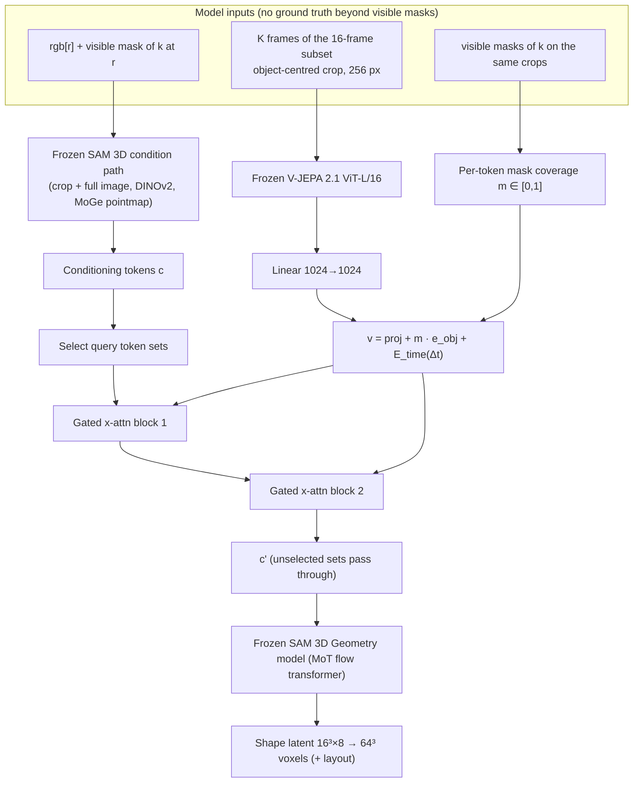

# Fusion Adapter: Design and Implementation Plan

> [!summary] What we build
> A small module (~18M parameters by default) that lets the **frozen** SAM 3D Geometry model see a **video clip**. SAM 3D's own conditioning tokens (from the reference frame) **cross-attend** to **frozen V-JEPA 2.1** tokens of an object-centred clip. The result is added back through **zero-initialised tanh gates**, so at step 0 the system is exactly SAM 3D. A learned **object embedding**, weighted by each token's mask coverage, tells the adapter which video tokens belong to the target.
> Parent plan: [[Research Plan - Video SAM 3D via V-JEPA 2.1 Fusion]] (conditions C1–C3, timeline, gates).

> [!warning] Assumptions marked **VERIFY**
> SAM 3D's internal tensor shapes, token sets, latent normalisation and attention mask are not documented in the paper at the level we need. Every item marked **VERIFY** is checked on Day 1–2 (§3). Each one has a default and a fallback, so no design decision blocks on it.

---

## 1. What the data format changes vs. plan v1

| Plan v1 assumed | Data format v0.1 says | Consequence for the adapter |
|---|---|---|
| Kubric MOVi-E, 24 frames @ 256 px | Own generator: **32 frames @ 512 px**, model side subsamples **16** | Stride-2 subsampling; random offset as augmentation |
| Objects on a ground plane, small linear camera motion | **1–4 floating objects**, camera **orbits 10–70°**, eased motion | More new viewpoints than MOVi-E → video should help more; arc span becomes a stratification axis |
| Occlusion proxy from visible pixels | **Exact amodal masks** and `visible_frac` per frame and object | Exact occlusion stratification (eval only; amodal is never a model input) |
| Split by GSO identity | **Train = Objaverse-XL (TRELLIS-500K), eval = GSO**, backgrounds hashed into pools | Cross-dataset generalisation is built in; we need our own **val split** from held-out Objaverse objects |
| Object size not an issue | Largest object in a test clip ≈ **2 % of the image** | **Object-centred clip crops are mandatory** for V-JEPA (§4.3); ask Julian to enlarge objects for M1 |
| Ground-truth latent conventions known | Canonical frame = **TRELLIS normalisation**; `ours_to_sam3d` layout converter **pending** | Train **shape-only first** (Phase A); add rotation once the converter is tested (Phase B) |
| Train data available | **Train split not generated yet** | Request a **dev slice** (500–1,000 Objaverse clips) now for loader, overfit and throughput tests |

---

## 2. Architecture overview



### 2.1 Tensor shapes (defaults)

| Tensor | Shape | Notes |
|---|---|---|
| Clip frames | (B, K, 3, 256, 256) | K ∈ {1, 4, 8, 16}; object-centred crop |
| V-JEPA tokens | (B, K/2 · 16 · 16, 1024) | 2,048 tokens at K = 16; K = 1 uses the **image tokenizer** (256 tokens) |
| Mask coverage m | (B, N_v) | same token order as V-JEPA output (t, h, w) — **VERIFY** order |
| Conditioning tokens c | (B, N_c, d_c) | **VERIFY** N_c and d_c (paper: 4 DINOv2 token sets + optional pointmap; shared width 1024) |
| Shape latent target | (B, 16, 16, 16, 8) → 4,096 tokens | from `voxels.npy` via SAM 3D's sparse-structure VAE encoder |

---

## 3. Day 1–2: inspect SAM 3D internals (owner: Model)

These checks set the defaults below. Record answers in §15.

- [ ] **Condition path.** Locate the module that produces the conditioning tokens. Print the token sets, their lengths, widths, and whether they carry modality embeddings. → decides `query_sets` (§6.4).
- [ ] **Time dependence.** Confirm conditioning tokens are computed once per sample, not per ODE step → the adapter runs once per sample.
- [ ] **CFG.** Find how the unconditional branch is built (null tokens? dropped streams?). The adapter must change **only the conditional branch** (§7).
- [ ] **Sampler and step-size input.** Is the released Geometry model shortcut-distilled (step-size input d)? For training use d = 0 (plain flow matching).
- [ ] **Time sampling.** Look for SAM 3D/TRELLIS defaults for the flow time τ (e.g., logit-normal). Default if absent: logit-normal(0, 1).
- [ ] **Latent normalisation.** Find mean/std scaling of the shape latent before the flow model (TRELLIS-style constants).
- [ ] **Attention mask between shape and layout streams.** Do shape tokens attend to layout tokens? → decides how layout tokens are fed during Phase A (§8.2).
- [ ] **Sparse-structure VAE encoder** (released 2026-06-01): find the input format (surface occupancy 64³ bool, like `voxels.npy`?).
- [ ] **Stage-1-only inference.** Find how to run the Geometry model and decode coarse voxels without the Texture & Refinement stage.

### 3.1 Two convention tests (gate G0, Day 3)

- [ ] **T5 — VAE round-trip:** encode → decode 50 GSO `voxels.npy`; mean IoU ≥ 0.9 expected. If much lower: surface vs. solid mismatch or wrong axis order.
- [ ] **T4 — canonical frame test:** run zero-shot SAM 3D on 30 large, unoccluded eval objects. Compare the predicted canonical voxels with GT under each of the 24 axis-aligned rotations of the cube.
  - If identity wins most often → frames match, use `voxels.npy` as is.
  - If one fixed permutation P wins consistently → apply P to all GT voxels before encoding.
  - If no consistent winner → SAM 3D's canonical frame is not TRELLIS's; switch to **Plan B1 (TRELLIS host)** or evaluate shape only with ICP.

---

## 4. Sample construction (owner: Data)

A training sample is a tuple **(clip, target object k, reference frame r, frame window W)**.

### 4.1 What the model may see

| Allowed as **input** | **Ground truth only** (targets / evaluation / analysis) |
|---|---|
| `rgb/*.png` | `mask_amodal/*`, `depth/*.npz` (except the explicit GT-pointmap oracle ablation) |
| `mask_visible/*.png` (target's visible mask; in real use: SAM 2/3 tracking) | `objects.json` poses, `cameras.json` |
| | `voxels.npy`, `mesh.glb`, `meta.json` visibility stats |

> [!danger] Leakage rule
> Amodal masks, depth, cameras and poses never enter the model in the main conditions. Crop windows are computed from **visible** masks only.

### 4.2 Frames, reference, window
1. **Subset:** S = frames {o, o+2, …, o+30}, with o ∈ {0, 1} random in training and o = 0 in eval → 16 frames covering the whole arc.
2. **Reference r:** uniform over S in training. Optional bias: sample r with probability ∝ (1 − visible_frac) for 50 % of samples, to see more occluded cases. Eval protocol: §11.
3. **Clip length K** ∈ {1, 4, 8, 16} with p = {0.15, 0.15, 0.2, 0.5}. W = contiguous window of K frames of S containing r (centred where possible). Coverage grows with K, like a longer video.
4. **Skip** samples where k has < 2 % of its amodal area visible at r — not possible by the generator guarantee (≥ 10 %), but keep the check.

### 4.3 Object-centred clip crop (needed because objects are small)
- Union of the target's **visible-mask** bounding boxes over the frames in W.
- Square side = max(1.25 × longest union side, 128 px), clamped to 512; same window for **all frames** (a moving crop would fake motion for V-JEPA).
- Pad outside the image with zeros (also pad the masks); resize to 256 × 256 (bilinear for RGB, `area` for masks so they become fractional).
- Training augmentation: jitter window centre ±10 % and side ×U(0.9, 1.1), identical for all frames.
- No flips (they change handedness and break the canonical-frame target).

### 4.4 Targets
- `voxels.npy` → (apply P from T4 if needed) → SAM 3D sparse-structure VAE encoder → latent z₁ (16³ × 8), normalised as in SAM 3D. **Cache per asset** (tiny; assets are shared across clips).
- Phase B only: rotation target R_co from `objects.json`/`cameras.json`, mapped by the tested `ours_to_sam3d`.

---

## 5. V-JEPA 2.1 tokens (owner: Features)

| Choice | Default | Why / alternative |
|---|---|---|
| Model | V-JEPA 2.1 **ViT-L/16** (official torch.hub or HF port), frozen, bf16 | Cheap next to the 1.2B flow model; ViT-g as stretch |
| Resolution | **256** (16 × 16 patches per frame) | 384 (24 × 24) as stretch ablation; 2.25× tokens |
| Features | **last layer** (1024-d) | Concatenated 4 hierarchical levels (4096-d → linear) as stretch ablation |
| Preprocessing | V-JEPA's own normalisation (ImageNet mean/std) | Must match the checkpoint config — **VERIFY** |
| Tubelets | 2 frames × 16 × 16; K/2 temporal positions | K = 1 → image tokenizer (`T = 1`), 256 tokens |
| Online vs. cached | **Online** in training (no_grad); **cached** for eval | Caching per (clip, object, window, augmentation) is ~4 MB per sample and blocks augmentation |

- [ ] **T3a:** check output token order (t, h, w) by feeding a clip whose frames differ only in one patch and locating the changed tokens.

---

## 6. Object focus and fusion module

### 6.1 Per-token mask coverage
For V-JEPA (tubelet 2, patch 16) on the 256-px crop:

```python
def token_coverage(mask_crop: torch.Tensor, patch: int = 16, tubelet: int = 2) -> torch.Tensor:
    """mask_crop: (B, K, H, W) fractional visible mask of the target on the clip crop.
    Returns (B, K//tubelet * H//patch * W//patch) in V-JEPA token order (t, h, w)."""
    B, K, H, W = mask_crop.shape
    m = F.avg_pool2d(mask_crop.flatten(0, 1)[:, None], patch)          # (B*K, 1, h, w)
    h, w = H // patch, W // patch
    m = m.view(B, K, h, w)
    if K > 1:                                                          # tubelet average
        m = m.view(B, K // tubelet, tubelet, h, w).mean(2)
    return m.flatten(1)
```

- [ ] **T3b:** overlay m on the crop for 20 samples; check Σ m · patch_area ≈ mask area.

### 6.2 Token embedding
For each V-JEPA token i with coverage mᵢ and tubelet offset Δtᵢ relative to the tubelet containing r:

$$\mathbf{v}_i = W_{\text{in}}\,\mathbf{f}_i + m_i\,\mathbf{e}_{\text{obj}} + E_{\text{time}}[\Delta t_i]$$

- `e_obj` ∈ ℝ¹⁰²⁴, init 𝒩(0, 0.02²); `E_time` = learned table over Δt ∈ [−7, 7] (15 entries).
- Optional ablations (off by default): an occluder embedding `e_occ` weighted by the coverage of *other* instances; or an attention-logit bias log(m + ε) instead of the embedding.

### 6.3 Gated cross-attention block (Flamingo-style)

```python
class GatedXAttnBlock(nn.Module):
    def __init__(self, d: int = 1024, heads: int = 16, ffn_ratio: float = 2.0):
        super().__init__()
        self.ln_q, self.ln_kv, self.ln_ff = nn.LayerNorm(d), nn.LayerNorm(d), nn.LayerNorm(d)
        self.attn = nn.MultiheadAttention(d, heads, batch_first=True)
        hid = int(d * ffn_ratio)
        self.ff = nn.Sequential(nn.Linear(d, hid), nn.GELU(), nn.Linear(hid, d))
        self.g_attn = nn.Parameter(torch.zeros(1))   # tanh(0) = 0 -> identity at init
        self.g_ff = nn.Parameter(torch.zeros(1))

    def forward(self, c, v, kv_padding_mask=None):
        kv = self.ln_kv(v)
        a, _ = self.attn(self.ln_q(c), kv, kv, key_padding_mask=kv_padding_mask, need_weights=False)
        c = c + torch.tanh(self.g_attn) * a
        c = c + torch.tanh(self.g_ff) * self.ff(self.ln_ff(c))
        return c


class VideoFusionAdapter(nn.Module):
    def __init__(self, d_cond=1024, d_vid=1024, n_blocks=2, max_dt=7):
        super().__init__()
        self.in_proj = nn.Linear(d_vid, d_cond)
        self.e_obj = nn.Parameter(torch.randn(d_cond) * 0.02)
        self.e_time = nn.Embedding(2 * max_dt + 1, d_cond)
        nn.init.normal_(self.e_time.weight, std=0.02)
        self.max_dt = max_dt
        self.blocks = nn.ModuleList(GatedXAttnBlock(d_cond) for _ in range(n_blocks))

    def forward(self, c_sel, f_vid, m, dt, kv_padding_mask=None):
        v = self.in_proj(f_vid) + m[..., None] * self.e_obj + self.e_time(dt + self.max_dt)
        for blk in self.blocks:
            c_sel = blk(c_sel, v, kv_padding_mask)
        return c_sel
```

- If d_cond ≠ 1024 (**VERIFY**), set `in_proj` to d_vid → d_cond and run the blocks at d_cond.
- **Gradient note:** at init only the gates receive gradient (∂L/∂g = sech²(0) · branch output ≠ 0); once g ≠ 0 all adapter weights train. This is Flamingo's behaviour. Log `tanh(g)` per block — if gates stay ≈ 0 after 1–2k steps, raise the gate learning rate ×10.
- `kv_padding_mask` handles batches with different K (pad V-JEPA tokens to the batch maximum).

### 6.4 Which conditioning tokens are queries
- **Default:** all RGB-derived token sets (crop + full image); mask and pointmap token sets pass through unchanged.
- Ablation (should-have): crop only vs. full image only.

### 6.5 Parameter count (d = 1024, FFN ratio 2)

| Part | Parameters |
|---|---|
| `in_proj` | 1.05 M |
| `e_obj`, `e_time` | 0.02 M |
| One gated block (attention 4.20 M + FFN 4.20 M + LN) | 8.4 M |
| **2 blocks (default)** | **≈ 17.9 M** |
| 3 blocks | ≈ 26.3 M |
| 4 blocks | ≈ 34.7 M → over budget; use FFN ratio 1 if tested |

---

## 7. Integration into SAM 3D (owner: Model)

- **Wrapper, not a fork:** subclass or wrap the condition-path module and replace its output with `merge(c, adapter(select(c), …))`. A forward hook that returns a modified output also works. Video inputs are passed through a context object set before calling the pipeline.
- **CFG:** apply the adapter before the conditional/unconditional batch is built, and only to the conditional tokens. **VERIFY** that the null-condition branch is untouched.
- **Run once per sample:** cache c' for all ODE steps.
- **Stage 1 only:** call the Geometry model and the coarse voxel decoder directly; skip Texture & Refinement in all experiments.

---

## 8. Training objective and loop

### 8.1 Loss (Phase A: shape only)
Rectified flow matching, as SAM 3D (paper eq. 1):

$$x_\tau = \tau\,x_1 + (1-\tau)\,x_0,\quad x_0 \sim \mathcal{N}(0, I),\qquad \mathcal{L}_S = \big\lVert (x_1 - x_0) - v_\theta(x_\tau, c', \tau, d{=}0) \big\rVert^2$$

Only the adapter receives gradients; SAM 3D, DINOv2, MoGe and V-JEPA stay frozen.

### 8.2 Layout tokens during Phase A
Depends on the attention-mask check in §3:
- **If shape tokens do not attend to layout tokens:** feed pure noise to the layout tokens and give them zero loss.
- **If they do:** use SAM 3D's own zero-shot layout prediction on the reference frame (cached from the C0 baseline run) as the layout "x₁". Noise it with the same τ, with no loss. This keeps the joint state in SAM 3D's own convention without needing `ours_to_sam3d`.

**Phase B (optional, after the converter passes its test):** add $\lambda_R \lVert v_R - \hat v_R \rVert^2$ with λ_R = 0.1 (paper weights).

### 8.3 Hyperparameters (starting point)

| Setting | Value |
|---|---|
| Optimiser | AdamW, lr 1e-4, betas (0.9, 0.999), weight decay 0.01 (none on gates, embeddings, LayerNorm) |
| Schedule | 500 warm-up steps, cosine to 1e-6 |
| Precision / memory | bf16 autocast; activation checkpointing on every frozen MoT block; frozen weights without gradients |
| Batch | 2–4 per GPU (measure), gradient accumulation to effective 32 |
| τ sampling | SAM 3D default if found, else logit-normal(0, 1) |
| Gradient clipping | 1.0 |
| EMA of adapter weights | 0.999 (evaluate EMA weights) |
| Steps | set from the D4 throughput test so one run takes ≤ 12–18 GPU-hours |

### 8.4 Validation
- **Val split:** 300–500 clips with Objaverse objects held out from training (ask Julian). GSO eval stays untouched until the final runs.
- Every 1k steps: flow loss on 200 val samples at a fixed τ grid {0.1, …, 0.9} with fixed noise (low variance, cheap).
- Every 5k steps: sampled shapes for 100 val objects → vIoU; keep the best EMA checkpoint.
- Diagnostics to log (also good report figures): `tanh(g)` per block; share of attention mass on tokens with m > 0.5; val metric vs. K.

---

## 9. Controls with the same code (C1, C2)

All conditions use the same adapter class, budget, seeds and data stream; only the key/value source changes.

| ID | Keys/values | Token grid | Notes |
|---|---|---|---|
| C1 | DINOv2 tokens of the **reference frame only** on the same clip crop | 224 px, patch 14 → 16 × 16 = 256 | Δt = 0; controls for fine-tuning and extra parameters |
| C2 | DINOv2 tokens of **K frames**, pairwise averaged ("DINOv2 tubelets") | 16 × 16 × K/2 → 2,048 at K = 16 | Exact token parity with V-JEPA |
| C3 | V-JEPA 2.1 tokens | 16 × 16 × K/2 | Main condition |

- Use **SAM 3D's own DINOv2 weights** for C1/C2, extracted from the pipeline.
- The coverage function works on the DINOv2 grid by setting `patch = 14` (at 224 px) and `tubelet = 2` (pair averaging) or 1 (C1).

---

## 10. Tests and sanity checks

- [ ] **T1 identity at init:** gates at 0 → adapted pipeline output equals SAM 3D's (max |Δc'| = 0; identical voxels with the same seed).
- [ ] **T2 gradients:** at step 0 only the gates have non-zero gradient; after ~10 steps all adapter weights do; frozen modules have none.
- [ ] **T3a/b** token order and coverage overlay (§5, §6.1).
- [ ] **T4/T5** canonical frame and VAE round-trip (§3.1).
- [ ] **T6 overfit:** 10 samples, loss → near 0 and decoded voxels match GT (vIoU > 0.8) within ~1k steps.
- [ ] **T7 wrong-video control:** at test time, give C3 the V-JEPA tokens of a different clip → performance must drop to ≈ C1 or below. Shows the adapter uses the right video, not a generic bias.
- [ ] **T8 paired randomness:** eval noise seeds depend only on (clip, k, r) → identical across conditions.

---

## 11. Evaluation protocol for the adapter

- **Samples:** all 500 GSO eval clips × all objects (≈ 1,075 objects at mean N = 2.15). Two reference frames per object: the middle frame (t = 16) and the most-occluded frame of S by `visible_frac` → ≈ 2,150 samples per condition. Clip input: full 16-frame subset (o = 0).
- **Sampler:** one fixed setting for all conditions (e.g., the distilled 4-step shortcut mode), same CFG.
- **Metrics on coarse 64³ output:**
  - canonical vIoU without alignment (tests canonical orientation);
  - paper protocol (normalise + ICP): vIoU, Chamfer, F-score on voxel-centre point clouds.
  - F-score thresholds: voxel size is 1/64 ≈ 0.016, so @0.01 is resolution-limited → report **@0.02 and @0.05**.
- **Stratification (from `meta.json` / amodal masks):** `visible_frac` at r in [0.1, 0.4), [0.4, 0.7), [0.7, 1.0]; amodal size terciles; `arc_span_deg` in 10–30 / 30–50 / 50–70; N.
- **Statistics:** paired Δ vs. C1 per sample; bootstrap 95 % CIs that **resample objects** (both reference frames together) and clips, so correlated samples aren't counted twice; Wilcoxon signed-rank.

---

## 12. Ablation priorities

| Priority | Experiment | Cost |
|---|---|---|
| **Must** | C1, C2, C3; C3-nomask (no `e_obj`) | 4 training runs |
| **Must** | Test-time K ∈ {1, 4, 8, 16}; frame shuffle (H3); wrong-video (T7) | eval only |
| Should | 3 blocks; query sets (crop only / full only) | 1–3 runs |
| Should | Full-frame clip instead of object-centred crop | 1 run |
| Could | 384 px; multi-level V-JEPA features; `e_occ`; attention-bias focus | 1 run each |
| Could | GT-depth pointmap oracle; Phase B rotation loss | 1 run each |

---

## 13. Schedule (maps onto the parent plan)

- [ ] **D1** SAM 3D internals checklist (§3) — *Model*; loader skeleton and crop logic — *Data*; V-JEPA wrapper — *Features*
- [ ] **D2** T4, T5, latent cache; T3a/b; request dev slice + val split — *Data*
- [ ] **D3 (G0)** Adapter + wrapper; T1, T2 — *Model*
- [ ] **D4** Training loop + validation; T6 overfit; throughput test → number of steps
- [ ] **D5 (G1)** 2-hour C3 pilot: gates move, val loss falls below C1's pilot? Launch full runs if the train split exists, otherwise train on the dev slice
- [ ] **D6–8** Full runs C1, C2, C3, C3-nomask (in parallel if GPUs allow)
- [ ] **D9** Eval + test-time ablations (K, shuffle, wrong-video); diagnostic plots

---

## 14. Code layout

```
fusion/
  data.py        # sample construction (§4): frames, reference, window, crop, coverage, targets
  encoders.py    # VJEPAWrapper, Dinov2Wrapper (SAM 3D's weights), shared preprocessing
  adapter.py     # GatedXAttnBlock, VideoFusionAdapter (§6)
  sam3d_wrap.py  # condition-path wrapper, CFG handling, stage-1-only inference (§7)
  train.py       # flow-matching loop, EMA, validation, logging (§8)
  eval.py        # sampling, metrics, stratification, bootstrap (§11)
  tests/         # T1–T8
configs/
  c1.yaml  c2.yaml  c3.yaml  c3_nomask.yaml
```

---

## 15. Open questions and decision log

**For Julian (data):**
- [ ] Can objects be larger for M1? The largest object ≈ 2 % of the image limits SAM 3D and V-JEPA alike. Suggestion: lower the camera-distance factor U(1.1, 1.6), or bias towards fewer objects in part of the data.
- [ ] ETA of the train split; can we get a 500–1,000-clip dev slice this week?
- [ ] A val split of held-out Objaverse objects.
- [ ] ETA of `ours_to_sam3d` (needed only for Phase B and layout evaluation).
- [ ] Near-duplicate check between GSO eval assets and the Objaverse training subset.

**Decisions** (static = read from the SAM 3D code, see `docs/sam3d_internals.md`; GPU = still to measure):

| Item | Default | Verified value / decision |
|---|---|---|
| Conditioning token sets, N_c, d_c | 4 DINOv2 sets, d = 1024 | Fused sets from `EmbedderFuser`, split by name at runtime; names and sizes: GPU (`inspect-sam3d`) |
| Query sets | RGB sets (crop + full) | RGB sets; names: GPU |
| CFG null branch | untouched | Zeros (`add_flag` + `force_zeros_cond`), never adapted (static; asserted) |
| τ distribution | logit-normal(0, 1) | logit-normal(0, 1) unless the yaml overrides it (static; GPU confirms) |
| Latent normalisation | SAM 3D constants | None: the generator uses the VAE mean directly (static) |
| Shape ↔ layout attention | unknown | Shape attends only to shape, so Phase A feeds layout noise (static; GPU test) |
| Canonical frame permutation P | identity | Identity expected (Z-up TRELLIS frame in the encoder demo); GPU (T4) |
| V-JEPA token order | (t, h, w) | Conv3d patch embedding, flatten (t, h, w) (static); GPU (T3a) |
| Batch size / steps per run | 2–4 / from throughput | GPU (benchmark) |
| Sampler for all conditions | distilled 4-step | Shortcut mode, 4 steps, no CFG |

---

## Related notes
[[Claude Code Prompt - Fusion Adapter Pipeline]] · [[Research Plan - Video SAM 3D via V-JEPA 2.1 Fusion]] · [[SAM 3D - 3Dfy Anything in Images]] · [[V-JEPA]] · [[DINOv2]] · [[Flow Matching]]
