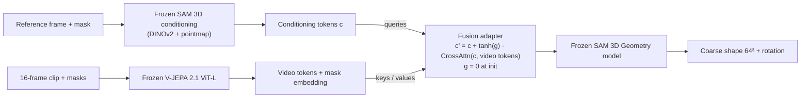

# Research Plan: Video Input for SAM 3D via V-JEPA 2.1 Embedding-Space Fusion

> [!info] Context
> Group mini research report. Background and proposals: [[SAM 3D - 3Dfy Anything in Images#7. Research question - from a single photo to video input|SAM 3D note §7]] and the encoder discussion in [[SAM 3D - 3Dfy Anything in Images#7.4 Video encoder - V-JEPA 2.1 and embedding-space fusion|§7.4]].
> **Guiding principle:** change as little as possible. SAM 3D and both encoders stay **frozen**; train **one small fusion module**; evaluate **coarse shape only** on a **synthetic dataset with full 3D ground truth**.

**Working title:** *Can video context help SAM 3D see behind occluders? Fusing V-JEPA 2.1 features into a frozen single-image 3D reconstructor.*

---

## 1. Research question & hypotheses

> [!question] Research question
> Does injecting temporally aggregated video features from a self-supervised video encoder into SAM 3D's conditioning space improve 3D shape reconstruction of partially occluded objects, without retraining SAM 3D?

| | Hypothesis | Comparison that tests it |
|---|---|---|
| **H1** | Video context improves shape accuracy over single-frame SAM 3D; the gain grows with occlusion of the reference frame | C3 vs. C0 / C1 |
| **H2** | Video features (V-JEPA 2.1) help more than per-frame image features (DINOv2) of the same frames, fused by the same module | C3 vs. C2 |
| **H3** *(optional)* | Part of the gain comes from temporal structure, not just more pixels | C3 vs. C3-shuf |

**Novelty.** SAM 3D is single-image. Lift4D adapts it to video through causal latent propagation (optimisation-based, not encoder fusion). MV-SAM3D (community fork) averages latents. To our knowledge nobody has fused a video encoder into SAM 3D's conditioning tokens.
- [ ] Novelty search (1 h) to confirm

**Course link** (fill in with curated papers): self-supervised representation learning (JEPA, DINOv2) · generative models (rectified flow matching) · attention-based fusion · 3D vision.

---

## 2. Feasibility facts (checked 2026-10-22)

- **SAM 3D release:** checkpoints (Nov 2025); **encoder weights released 2026-06-01** (needed to encode ground-truth shapes into SAM 3D's latent space); SA-3DAO dataset + leaderboard (2026-06-02). Repo ships **inference code only** → we write a small flow-matching training loop ourselves.
- **SAM 3D hardware/access:** NVIDIA GPU with **≥ 32 GB VRAM**; checkpoints are **gated on Hugging Face** → request on day 1.
- **V-JEPA 2.1:** learnable image/video modality tokens → same encoder works on single images and clips. Use ViT-L to save compute.
- **Kubric MOVi-E:** ~10k videos, 11–23 Google Scanned Objects (GSO) per scene, small linear camera motion, 24 frames at 256 px, with instance masks, depth, object and camera poses. Objects occlude each other naturally; ground-truth meshes come from GSO → **no rendering pipeline needed**.

---

## 3. Minimal method (one module)

> [!info] Detailed design
> Shapes, code skeleton, training loop, tests and decision log: [[Fusion Adapter - Design and Implementation Plan]].

- **Fusion adapter:** 2–4 cross-attention blocks (~10–30M parameters). SAM 3D's own conditioning tokens attend to the clip's V-JEPA tokens; the output is added back, scaled by a learnable gate initialised to **zero** → exactly SAM 3D at the start.
- **Object focus:** add a learned embedding to each V-JEPA token, weighted by the fraction of the target mask it covers (cheap object-centric pooling).
- **Training:** SAM 3D's rectified flow-matching loss on the ground-truth shape latent and rotation (paper weights S = 1.0, R = 0.1); gradients flow only into the adapter.
  - Random clip length K ∈ {1, 4, 8, 16} during training → one model serves all test-time ablations.
  - Cache all encoder features offline (16 frames × 256 px ≈ 2,048 V-JEPA tokens ≈ 4 MB fp16 per clip).
- **Scope limits:** Geometry model only (no Texture & Refinement), SAM 3D's default monocular pointmap, evaluate shape (rotation optional).

---

## 4. Experimental design

### 4.1 Data

> [!warning] Superseded by data format v0.1 (2026-10-26)
> We now use our own generator instead of MOVi-E: 32 frames @ 512 px (model uses 16), 1–4 floating objects, orbiting camera (10–70°), exact amodal masks. **Train = Objaverse-XL (10k clips, not generated yet), eval = GSO (500 clips).** The MOVi-E bullets below are kept for history; see [[Fusion Adapter - Design and Implementation Plan#1. What the data format changes vs. plan v1|adapter plan §1]] for the consequences.

- MOVi-E, split by **GSO object identity** (~80/20) to avoid leakage.
- One target object per sample, visible in ≥ 8 of 16 frames, random reference frame.
- ~3k training clips, ~400 test clips; filter targets below a minimum pixel area.
- **Occlusion proxy:** target's visible pixels in the reference frame ÷ its maximum over the clip → bins low / medium / high.

### 4.2 Conditions (same budget, seed, steps for all trained ones)

| ID | Condition | Purpose |
|---|---|---|
| C0 | SAM 3D, reference frame only (zero-shot) | Lower bound |
| C0b | SAM 3D on the least-occluded frame of the clip | Strong training-free baseline |
| C1 | Adapter, keys/values = reference-frame DINOv2 only | **Controls for domain fine-tuning and extra parameters** |
| C2 | Adapter, keys/values = DINOv2 tokens from K frames | Video information via an image encoder (H2) |
| **C3** | **Adapter, keys/values = V-JEPA 2.1 tokens (main)** | H1, H2 |
| C3-shuf | C3 with shuffled frames at test time | H3 |
| C3-nomask | C3 without the mask embedding | Ablation |

> [!warning] C1 is the most important control
> Without it, any gain could simply be adaptation to the MOVi domain.

### 4.3 Metrics & statistics
- **Shape** (paper protocol D.3.1: normalise + ICP): voxel IoU at 64³, Chamfer distance, F-score@0.01 on sampled points. Optional: geodesic rotation error.
- **Statistics:** paired per-sample differences, bootstrap 95 % CIs, Wilcoxon signed-rank test; 2 seeds for C1–C3 if time allows.

### 4.4 Planned results
- [ ] Main table C0–C3
- [ ] Occlusion plot (metric vs. occlusion bin) — where H1 should appear
- [ ] Scaling plot (metric vs. K); at K = 1, C3 ≈ C1
- [ ] Shuffle and mask ablations
- [ ] Qualitative grid
- [ ] *Stretch:* zero-shot on 30–50 real CO3D / OmniObject3D clips with SAM 2 masks

---

## 5. Timeline & gates

> [!tip] Fill in calendar dates for D1–D15 once the start day is fixed.

### Week 1 — setup, data, baselines
- [ ] **D1** Request HF access (SAM 3D), secure GPU (≥ 40–80 GB ideal), assign roles, novelty search, map to course papers
- [ ] **D1–2** SAM 3D inference on MOVi frames; encode ground-truth voxels with released encoder; fix coordinate conventions (transform an unoccluded zero-shot prediction and check it lines up with the GT mesh)
- [ ] **G0 (D3)** Latents and conventions verified → else switch to **Plan B1**
- [ ] **D2–4** MOVi extraction, GT voxels, masks, occlusion proxy, splits; cache DINOv2 and V-JEPA features
- [ ] **D4–5** Evaluation script; C0 and C0b results; training loop overfits 10 clips
- [ ] **G1 (D5)** Baselines + overfit test pass → else **Plan B2**
- [ ] Draft Related Work + Introduction in parallel

### Week 2 — training & experiments
- [ ] **D6–8** Train C1, C2, C3; evaluate incl. occlusion bins
- [ ] **D9** Test-time ablations: K scaling, shuffling, mask off; stretch real-data test if ahead
- [ ] **G2 (D10)** Freeze all numbers — no new experiments after this

### Week 3 — writing & buffer
- [ ] **D11–12** Figures; full draft of Methods and Experiments
- [ ] **D13** Internal review; rewrite Introduction and Discussion
- [ ] **D14–15** Buffer for other obligations, polishing, submission

---

## 6. Roles (3–4 people)

| Role | Owns |
|---|---|
| **Model** | SAM 3D integration, adapter, training loop; gate G0 |
| **Data** | MOVi pipeline, GT voxels, occlusion statistics, splits |
| **Features & evaluation** | Encoder caching, metrics, baselines, statistics, plots |
| **Writing & backup** | Related work, method figure, report skeleton; keeps Plan B2 ready |

Everyone writes in week 3.

---

## 7. Backup plans (reuse the same data and cached features)

- **B1 — same idea, different host model.** If SAM 3D latents or conventions aren't sorted by D3, put the identical adapter into **TRELLIS** (SAM 3D's base architecture, open training code). Frame as a proof of concept on SAM 3D's backbone.
- **B2 — probing study (no generative training).** *Do frozen V-JEPA 2.1 features encode the shape of occluded objects better than DINOv2?* Train small probes from mask-pooled features (reference frame vs. clip) to a 32³ occupancy grid of the target, stratified by occlusion. One 24 GB GPU; still tests H1/H2 at the representation level. A complete mini-project on its own.
- **B3 — minimum fallback.** C0 vs. C0b plus feature analysis (PCA visualisations, cross-frame feature similarity), honestly framed as a diagnostic / negative result.

---

## 8. Report mapping

| Section | Content |
|---|---|
| Abstract | RQ, method in one sentence, main finding with the occlusion-stratified number |
| Introduction & contributions | Single-image limits (SAM 3D §F), why video helps, H1–H3; contributions: adapter, controlled benchmark, analysis |
| Related work | SAM 3D / TRELLIS; V-JEPA 2 / 2.1, DINOv2; video & multi-view 3D (Lift4D, MV-SAM3D, VGGT); feature probing (Lexicon3D, El Banani et al.) |
| Methods | Extended formulation $p(S, R \mid \{I_k, M_k\}_{k=1}^K)$, adapter, zero-init gate, mask embedding, objective |
| Experiments & results | Setup, conditions table, main table, occlusion plot, K-scaling plot, ablations, qualitative results |
| Discussion & conclusion | Synthetic→real gap, small camera motion in MOVi-E, coarse shape only, frozen backbone; future work (3D-anchored fusion F3, DPO) |

**Original figures:**
- [ ] Teaser: occluded object, C0 vs. C3
- [ ] Method diagram
- [ ] Data examples + occlusion histogram
- [ ] Main / occlusion / K-scaling plots
- [ ] Qualitative grid
- (Borrowed, cited, at most: one SAM 3D architecture sketch)

---

## 9. Risks

| Risk | Mitigation |
|---|---|
| HF access delay or GPU < 32–40 GB | Request day 1; backprop through the frozen 1.2B model probably needs 40–80 GB (bf16 + gradient checkpointing); otherwise Plan B2 |
| Coordinate-frame mismatch (MOVi vs. SAM 3D) | Day-2 alignment check; shape metrics use ICP and tolerate it |
| MOVi objects are small (256 px) | Minimum pixel-area filter; small occluded objects are also a realistic stress test |
| Small camera motion → little new viewpoint information | State as limitation; gains come from moving occluders and changing visibility, which is what H1 targets |
| Adapter overfits on ~3k clips | Zero-init gate, small adapter, early stopping on validation split, random reference frames as augmentation |

---

## 10. Key references for this project
- SAM 3D Team (2025). *SAM 3D: 3Dfy Anything in Images.* [arXiv:2511.16624](https://arxiv.org/abs/2511.16624) · [Code](https://github.com/facebookresearch/sam-3d-objects)
- Mur-Labadia et al. (2026). *V-JEPA 2.1: Unlocking Dense Features in Video Self-Supervised Learning.* [arXiv:2603.14482](https://arxiv.org/abs/2603.14482) · [Code](https://github.com/facebookresearch/vjepa2)
- Assran et al. (2025). *V-JEPA 2.* [arXiv:2506.09985](https://arxiv.org/abs/2506.09985)
- Oquab et al. (2023). *DINOv2.* [arXiv:2304.07193](https://arxiv.org/abs/2304.07193)
- Xiang et al. (2025). *TRELLIS: Structured 3D Latents.* [arXiv:2412.01506](https://arxiv.org/abs/2412.01506) (Plan B1 host)
- Greff et al. (2022). *Kubric / MOVi.* [arXiv:2203.03570](https://arxiv.org/abs/2203.03570) · Downs et al. (2022). *Google Scanned Objects.* [arXiv:2204.11918](https://arxiv.org/abs/2204.11918)
- Litman et al. (2026). *Lift4D.* [arXiv:2606.23688](https://arxiv.org/abs/2606.23688) — closest prior work
- Man et al. (2024). *Lexicon3D.* [arXiv:2409.03757](https://arxiv.org/abs/2409.03757) · El Banani et al. (2024). *Probing the 3D Awareness of Visual Foundation Models.* CVPR — for Plan B2
- Liu et al. (2022). *Rectified Flow.* [arXiv:2209.03003](https://arxiv.org/abs/2209.03003)
- Alayrac et al. (2022). *Flamingo* (gated cross-attention, zero-init `tanh` gating). [arXiv:2204.14198](https://arxiv.org/abs/2204.14198)

---

## Related notes
[[SAM 3D - 3Dfy Anything in Images]] · [[V-JEPA]] · [[DINOv2]] · [[TRELLIS]] · [[Flow Matching]]
