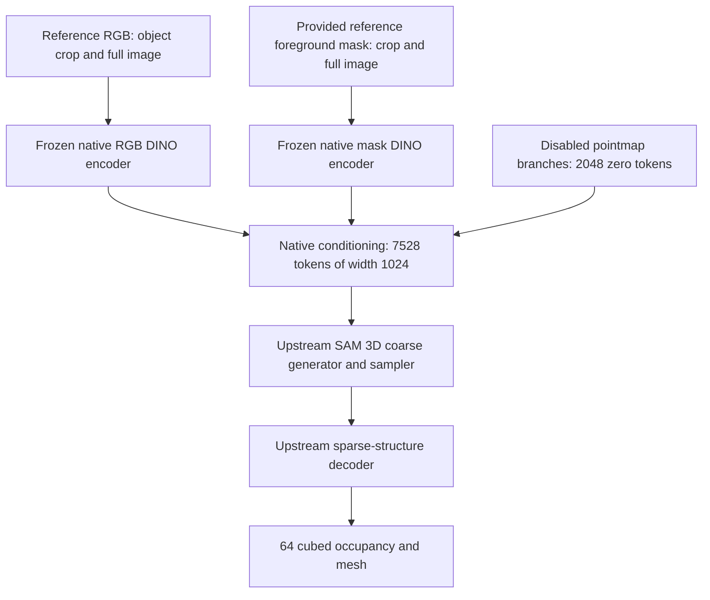
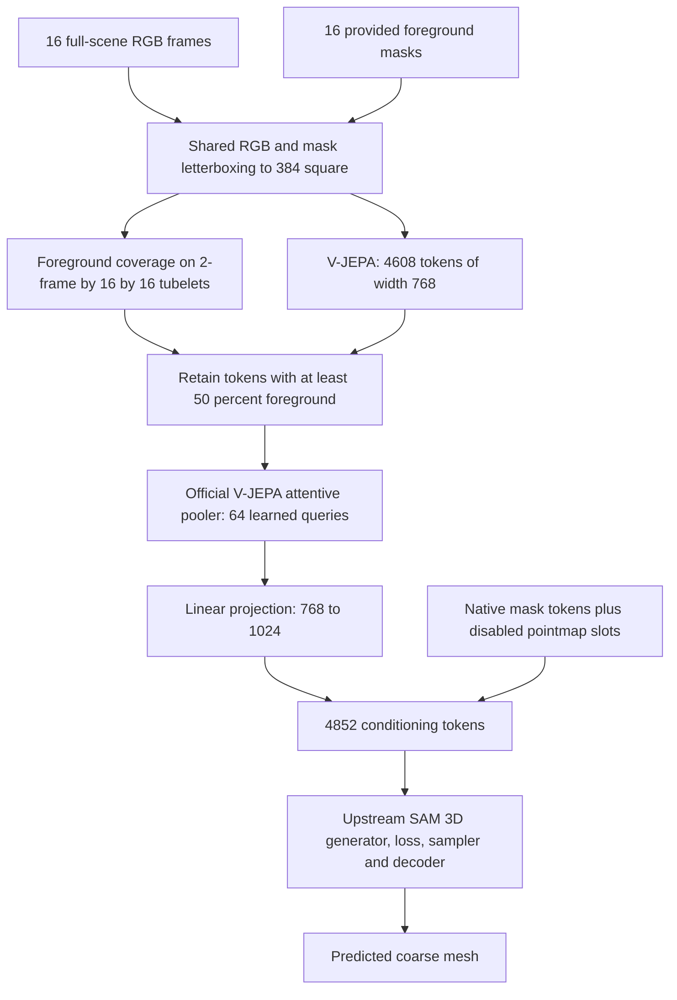

# Mask-aware video conditioning for SAM 3D

## Research question

Does additional object coverage in a video improve coarse object geometry over a single reference image, particularly on surfaces first revealed after the reference frame? The output is a selected object's coarse occupancy/mesh, not a learned segmentation mask. NAVI supplies input object masks and aligned ground-truth scans.

## Native image path

The pinned fuser concatenates RGB crop (1370), RGB full image (1370), mask crop (1370), mask full image (1370), pointmap crop (1024), and pointmap full image (1024). The pointmap branches are zeroed through upstream force-drop configuration. They do not provide object selection. The supplied foreground mask does: the mask DINO encodes it; DINO does not generate that mask.

## Previous pilot

The previous video path masked/cropped each frame, encoded 16 frames with V-JEPA 2.1 ViT-B/16, averaged the eight temporal tubelet positions, projected 576 spatial tokens from width 768 to 1024, and appended them to all 7528 native conditioning tokens. Thus native RGB and mask conditioning both remained. This was a learned linear connector after temporal averaging, not an attentive pooler.

All four adapted models performed worse than the untouched native image baseline in the first 25-update pilot. The dataset is extremely small and scan normalization does not establish rotational alignment with SAM's canonical axes. See [the recorded results](Assignment%203%20-%20Group/code/RUN_RESULTS.md).

## Mask-aware attentive pooler

There is no temporal averaging. Each learned query cross-attends to the selected video tokens. The official depth-one `AttentivePooler` contains a cross-attention block, residual connection, normalization and MLP. It is a transformer-style pooling module. Its 64 queries are initialized and trained here; this is not a pretrained task-specific classification head. At greater depth the official implementation adds self-attention blocks, but this run uses depth one.

The RGB and masks undergo the same square letterbox transform. RGB uses bicubic interpolation; masks use nearest-neighbor interpolation. V-JEPA still sees scene context. Foreground selection happens after encoding, so retained object features may contain contextual information. This is not attention masking inside V-JEPA. Tubelet foreground coverage is averaged over two frames and a 16 by 16 patch, then thresholded at 0.5. An empty selection fails explicitly. Samples with different foreground counts are pooled separately, without padded tokens.

The connector replaces the first 2740 native RGB tokens. It retains both native reference-mask streams (2740 tokens) and both disabled pointmap slots (2048 tokens): 64 + 2740 + 2048 = 4852. Reference-mask conditioning still supplies the identity and reference image location of the object. Per-frame masks identify its video tokens. There is no new pointmap predictor. Native zero pointmap slots remain for compatibility.

## Training and controls

Reuse the pinned upstream SAM 3D generator, sparse-structure VAE, sampler and flow-matching loss. Only canonical shape is supervised; pose/layout loss weights are zero and shortcut self-consistency is disabled. No model or loss implementation is rewritten.

All four variants train the 6,546,432-parameter official attentive pooler and 787,456-parameter linear projection. A freezes both backbones; B adds video attention LoRA; C adds SAM shape cross-attention LoRA; D adds both. Rank and alpha are eight. Checkpoints contain all trainable pooler, connector and adapter parameters plus optimizer, scheduler, RNG and progress.

Each variant evaluates untouched native image-only SAM, the adapted model with the reference RGB and mask repeated 16 times, and the adapted model with the real video and corresponding masks. Generation uses matched noise seeds. Native baseline evaluation disables SAM LoRA and retains the entire original reference conditioning.

Use two training objects and two held-out validation objects from fixed object-disjoint NAVI pools, with up to two clips each. Run 25 updates at effective batch four. Test objects stay untouched. This is an integration and optimization pilot, not evidence of generalization. Because pooling, RGB replacement, and video preprocessing change together, comparison with the previous pilot cannot isolate the pooler's effect.

## Loss and visible evaluation

Random training losses differ in clips and diffusion noise and need not decrease monotonically. Record fixed-seed flow loss on every validation clip and one fixed training probe at step zero and every five updates. Report initial and final values honestly. A rising fixed training probe indicates an optimization concern; improved training with worsening validation suggests overfitting or mismatch. Neither alone establishes better geometry.

W&B `eval/video/failed` is a scalar failure fraction, never a video. Direct panels under `final/<example>/` show `input_video`, `reference_rgb`, `reference_mask`, `ground_truth_mesh`, `native_sam3d_coarse_mesh`, `our_repeated_reference_mesh`, and `our_video_mesh`. Mesh panels use actual GLB surfaces. The comparison table labels its sampled geometry as point clouds; the SDK does not support GLB Object3D inside artifact-backed tables. Reconstruction artifacts pair downloadable GLBs, input MP4, reference/mask, occupancy logits, metrics and identifiers.

`training_assets/<object>/` shows the actual ground-truth mesh and video used for training. The training dataset artifact also retains encoded geometry targets. These are separate from held-out final evaluation objects.
